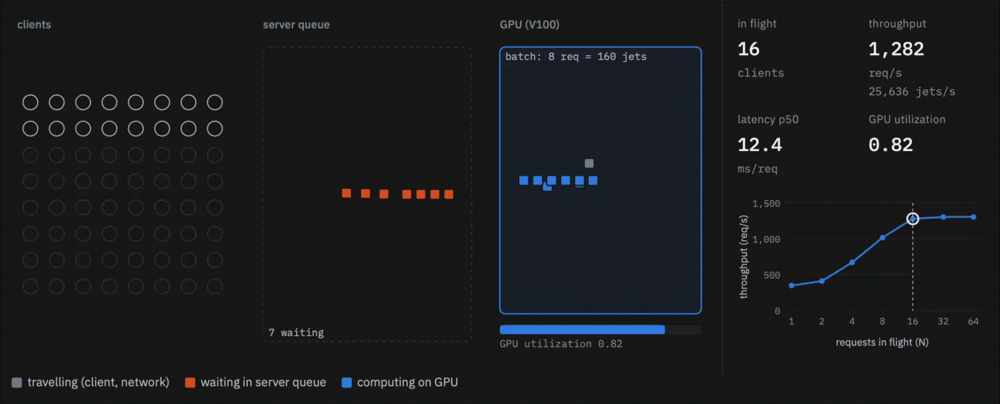

# Load tests

Drive the TARDIS-managed Tritons with real inference requests. Before you run anything, remove `simulated_utilisation_file` from `configuration/cobald_htc.yml`. Otherwise
TARDIS ignores the real metrics.

Model: `particlenet_AK4_PT`. The ONNX models in the CMSSW repository fail on the
V100 nodes (`cudaErrorNoKernelImageForDevice` with the `tritonserver:24.11`
onnxruntime). Only the `pytorch_libtorch` models (`*_PT`) work there.

## Run order

Run every command from `scripts/loadtest/` with the `tardis-venv` python.
Terms used below:

- **jet**: one input row of the model.
- **request**: one gRPC call, carrying a batch of jets (one event).
- **C**: the request rate one drone sustains. E1 measures it.

### E0: sanity check

Sends one request to every drone in `output/endpoints.json` and prints which GPU
each drone reports. Use it to confirm that every drone answers, before you
put load on them.

```bash
python loadgen.py --sanity
```

### E1: calibration (capacity of one drone)

`calibrate.sh` runs `perf_analyzer` against one drone in a closed loop: N
clients each keep one request in flight, for N = 1, 2, 4 … 64. perf_analyzer
measures each step in 30 s windows until 3 windows agree within 10 %. The
sweep runs 5 times, and the plot shows the mean ± std between runs.
Every request carries 20 jets (50 PF candidates, 5 SVs). The sweep records
throughput, latency and GPU utilisation.

**C** is the throughput at the knee: the lowest N that reaches 95 % of peak
throughput. Below the knee the GPU has idle time. Above it, extra requests
only wait in the queue. `C [req/s] = Inferences/s ÷ batch`.

Stop TARDIS once the drone is up, so that nothing scales during the sweep.

```bash
./calibrate.sh [drone_uuid]        # default: first drone in endpoints.json
python ../plotting/plot_calibration.py ../../output/loadtest/calibration-<ts>
```

Then set `scale:` in `profiles/e*.yaml` to C, or pass `--scale <C>`. The run
on 2026-10-21 (one V100) gave C ≈ 1,282 req/s at N = 16, with GPU utilisation 0.82.




### E2–E4: scaling runs

`loadgen.py` sends open-loop Poisson traffic. Its rate follows the profile, in
units of C. TARDIS must be running. Each run checks that the number of drones
follows the load.

| Run | Profile | Load (× C) | Checks |
|---|---|---|---|
| E2 step | `e2_step.yaml` | 0.3 for 5 min → 2.5 for 15 min → 0.3 for 15 min | scale-up to 3 drones, then scale-down |
| E3 ramp | `e3_ramp.yaml` | 0 → 3 over 20 min, then 3 → 0 over 20 min | the drone count tracks a slow change |
| E4 random | `e4_random.yaml` | random walk in 0.1–3 for 40 min, plus a 2× burst of 20 s every 5 min | stability under noisy load and short bursts |

`profiles/dryrun.yaml` (1 req/s for 60 s) checks only the tooling: compare the
`ok` rows in `requests.csv` with the Prometheus counter.

```bash
python loadgen.py profiles/e2_step.yaml          # or --scale <C>
python fetch_prometheus.py ../../output/loadtest/e2_step-<ts>
python ../plotting/plot_tardis.py                # check the drone count first
python ../plotting/plot_loadtest.py ../../output/loadtest/e2_step-<ts>
```

Check `plot_tardis.py` first. It plots TARDIS demand and supply from
`output/tardis.log`, which shows whether TARDIS started the right number of
Triton servers. The plot goes to `output/tardis_plots/`. With
`--prometheus ../../output/loadtest/e2_step-<ts>`, it uses the real GPU
utilisation instead of the gappy log values.

`fetch_prometheus.py` finds Prometheus through the ClusterIP of
`monitoring/prometheus`. Use `--prom` or `$PROM_URL` to override it. It also
checks that the number of successful requests per drone matches between
`requests.csv` and Prometheus.

## Outputs (`output/loadtest/<run>/`)

| File | Content |
|---|---|
| `requests.csv` | One row per request: `ok`, `error`, `dropped` (client in-flight cap), or `no_endpoint` |
| `meta.json` | Profile, scale, seed, start/end time |
| `prometheus.csv` | GPU util, success/failure rate, queue/compute time per request, batch per exec, `up` |
| `timeline.png` | Offered vs achieved rate · TARDIS demand/supply · utilisation and thresholds · latency/errors · queue time |
| `distribution.png` | Successful requests per drone over time |
| `drones.png` | TARDIS state per drone, plus the first request each drone served |

## Notes

- The PyTorch model takes ~15 s to warm up: the first requests per drone run at
  ~1 s, then drop to ~15 ms. New drones show the same spike.
- The generator is open-loop: requests arrive as a Poisson process whose rate
  follows the profile, no matter how fast the servers answer. That way
  unserved demand shows up as rising latency and utilisation, not as a lower
  send rate.
